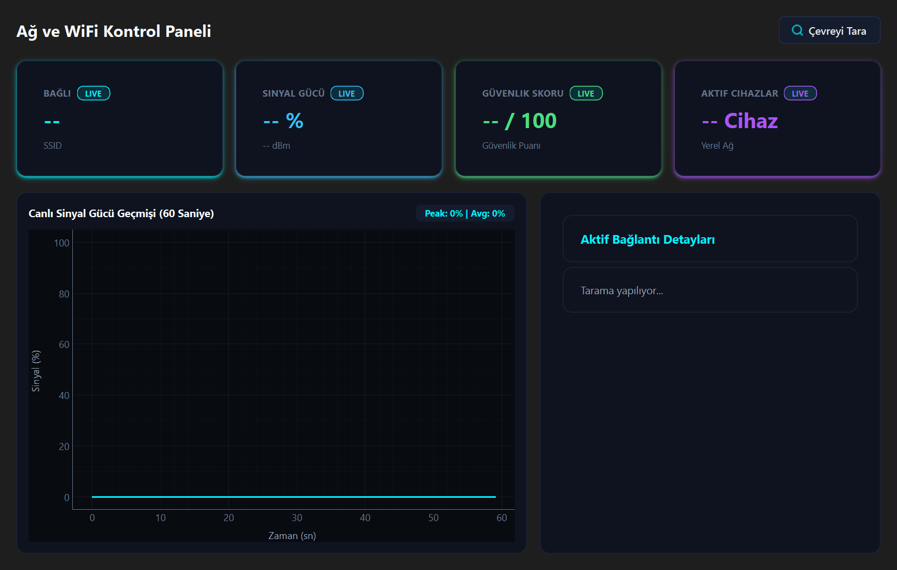
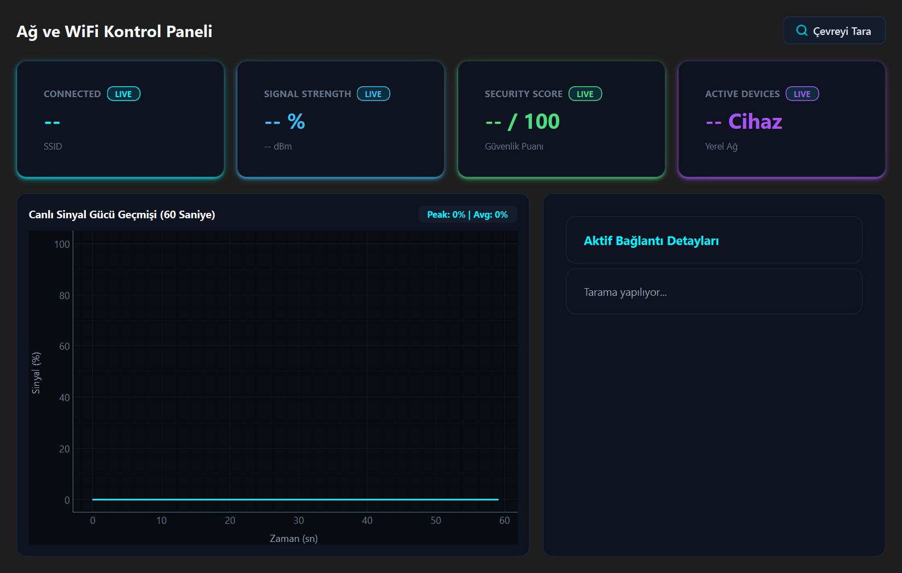
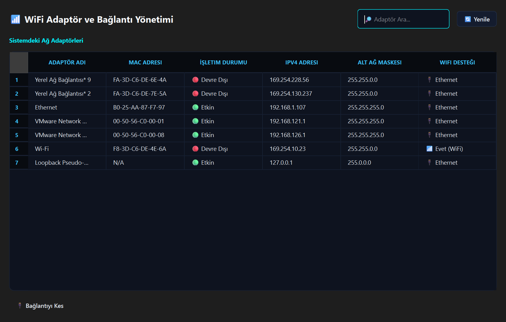
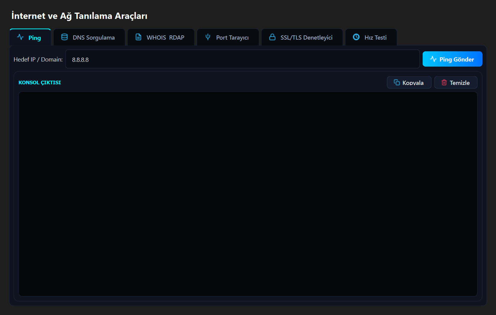
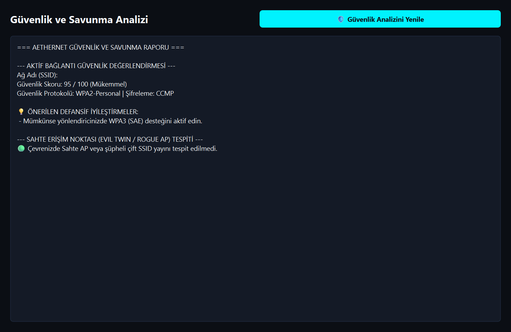
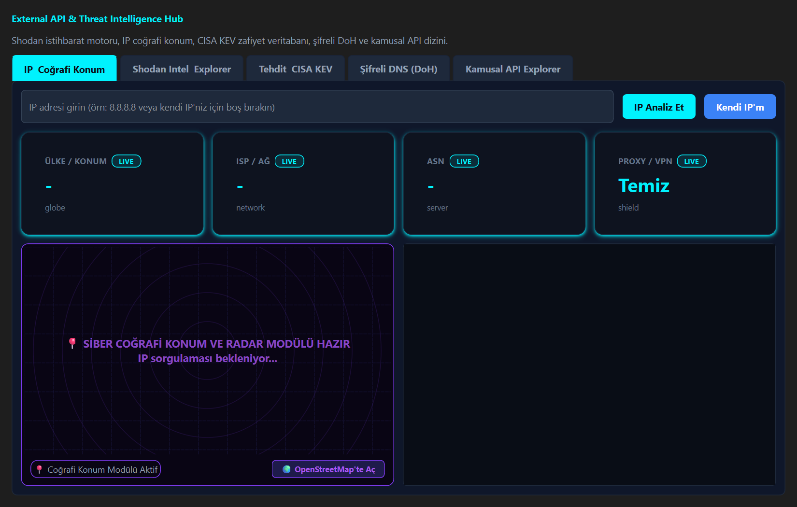
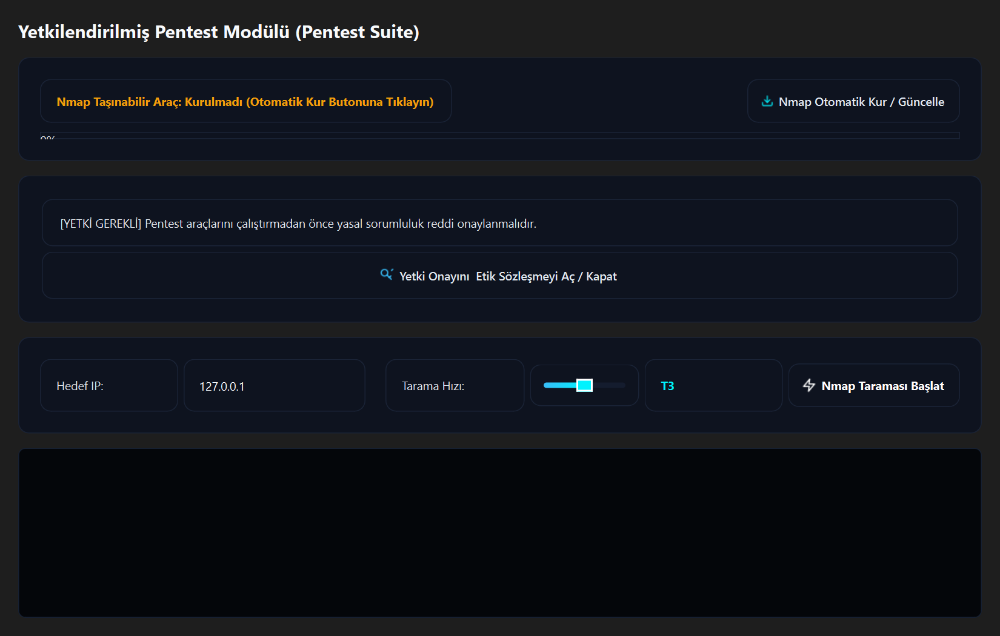

# ⚡ AetherNet - WiFi & Ağ Yönetim Hub'ı (WiFi & Network Management Hub)

[](https://www.python.org/)
[](https://pypi.org/project/PySide6/)
[](dist/AetherNet.exe)
[](LICENSE)

> **AetherNet**, kablosuz ağ adaptörlerinizi, aktif bağlantılarınızı, kayıtlı profillerinizi ve çevrenizdeki WiFi ortamını eksiksiz görüntüleyip yönetmenizi sağlayan; aynı zamanda gelişmiş ağ tanılamaları, yerel cihaz envanteri, harita & coğrafi konum istihbaratı, güvenlik/savunma analizleri, AI sağlayıcıları ve yetkilendirilmiş pentest araç entegrasyonlarını tek bir Cyber-Noir arayüzde birleştiren yüksek performanslı masaüstü ağ yönetim hub'ıdır.

---

## 🇹🇷 Türkçe Dokümantasyon

### 📸 Ekran Görüntüleri (UI Previews)

| Kontrol Paneli (Dashboard) | WiFi Adaptör & Bağlantı |
| :---: | :---: |
|  |  |

| Ağ Tanılama Araçları | Güvenlik & Savunma Analizi |
| :---: | :---: |
|  |  |

| API Hub & Coğrafi Konum Haritası | Certified Pentest Orchestrator |
| :---: | :---: |
|  |  |

---

### 📋 İçindekiler

1. [Proje Vizyonu](#-proje-vizyonu)
2. [Modül ve Özellik Detayları](#-mod%C3%BCl-ve-%C3%B6zellik-detaylar%C4%B1)
3. [Proje Mimarisi ve Klasör Yapısı](#-proje-mimarisi-ve-klas%C3%B6r-yap%C4%B1s%C4%B1)
4. [Sistem Gereksinimleri ve Kurulum](#-sistem-gereksinimleri-ve-kurulum)
5. [Güvenlik, Gizlilik ve Etik Onay](#-g%C3%BCvenlik-gizlilik-ve-etik-onay)
6. [Geliştirici & Lisans](#-geli%C5%9Ftirici--lisans)

---

### 🌐 Proje Vizyonu
AetherNet, hem günlük kullanıcılar için *"WiFi'ım neden yavaş?"* veya *"Ağımda kimler var?"* sorularına anında yanıt veren pratik bir kontrol paneli, hem de sistem yöneticileri ve güvenlik uzmanları için genişletilebilir, tip güvenli bir ağ analiz platformudur.

---

### 🛠️ Modül ve Özellik Detayları

#### 1. 📶 WiFi Adaptör & Bağlantı Yönetimi
- **Adaptör İnceleme**: Sistemdeki tüm ağ arayüzlerinin listelenmesi (WiFi, Ethernet, Sanal Adaptörler), MAC adresleri, sürücü sürümleri ve işletim durumları.
- **Canlı Sinyal Takibi**: `pyqtgraph` ile donmadan güncellenen 60 saniyelik sinyal geçmişi grafiği (% ve dBm cinsinden RSSI).
- **Bağlantı Parametreleri**: Aktif SSID, BSSID, radyo standartları (802.11a/b/g/n/ac/ax/be), frekans bandı (2.4/5/6 GHz), kanal genişliği (20/40/80/160 MHz) ve şifreleme tipleri (WPA3-Personal, WPA2-PSK, WEP, Open).
- **Bant Genişliği Sayaçları**: Anlık indirme/yükleme link hızları (Mbps) ve alınan/gönderilen toplam byte/paket sayıları.

#### 2. 🔑 Kayıtlı WiFi Profilleri Yönetimi
- **Profil Listesi**: Sistemde kayıtlı tüm WiFi ağlarının ve güvenlik tiplerinin listelenmesi.
- **Parola Görüntüleme**: Yerel makinede kayıtlı ağ şifrelerinin yönetici izniyle güvenli şekilde görüntülenmesi ve ThreadPoolExecutor yüksek hızlı kurtarma.
- **Profil Kontrolü**: Ağ bağlantısını tetikleme veya mevcut bağlantıyı kesme.

#### 3. 🔍 Çevresel Ağ & Ortam Taraması
- **Canlı Ortam Taraması**: Çevredeki tüm görünür ve gizli (hidden) SSID/BSSID'lerin listelenmesi.
- **Kanal Çakışma Analizi**: 2.4 GHz ve 5 GHz bantlarında kanal yoğunlukları ve en uygun kanal önerileri.

#### 4. 💻 Yerel Ağ Keşfi & Cihaz Envanteri (ARP Inventory)
- **ARP Taraması**: Aynı alt ağdaki tüm aktif IP ve MAC adreslerinin tespiti.
- **MAC → OUI Üretici Eşleştirme**: Cihazların üreticilerini (Apple, Samsung, Raspberry Pi, TP-Link, Cisco vb.) otomatik tespit etme.
- **Cihaz Tipi Tahminleme**: Router, Akıllı Telefon, IoT cihazı, Sanal Makine veya Bilgisayar sınıflandırması.

#### 5. 🛠️ İnternet ve Ağ Tanılama Araçları
- **📍 Ping & Jitter**: Min/Max/Avg gecikme süreleri, paket kaybı ve seğirme (jitter) analizi.
- **🌐 DNS Sorgulama**: A, AAAA, MX, TXT, NS, CNAME, SOA ve PTR (Ters DNS) kayıtları.
- **🔎 WHOIS & RDAP**: Alan adı kayıt süreleri, registrar ve kamuya açık IP coğrafi konum/ASN bilgileri.
- **🔌 TCP Port Tarayıcı**: Yaygın ve özel portlar için çok izlekli (multithreaded) bağlantı testi.
- **🔒 SSL/TLS Denetleyici**: Sertifika geçerliliği, bitiş tarihi, son gün sayısı, TLS versiyonu ve cipher paketleri.
- **🚀 Bandwidth Speedtest**: İndirme, yükleme ve ping hızı ölçümü (En yakın düşük gecikmeli sunucu düğümü seçimi ile).

#### 6. 🛡️ Güvenlik & Savunma Modülleri
- **Ağ Güvenlik Skoru**: Şifreleme standartları, açık ağ riski ve WPS durumuna göre 0-100 arası güvenlik skoru.
- **Sahte AP (Evil Twin / Rogue AP) Tespiti**: Aynı SSID'nin yetkisiz BSSID'lerden veya farklı şifreleme yöntemleriyle yayınlanması durumunda otomatik uyarı.

#### 7. 🤖 AI Sağlayıcı Entegrasyonu
- **Çoklu AI Desteği**: Doğal dilde ağ analizi ve tanılama için DeepSeek, Groq Cloud ([console.groq.com/keys](https://console.groq.com/keys)), Mistral AI ([console.mistral.ai](https://console.mistral.ai/)), OpenAI, Anthropic Claude, Google Gemini ve yerel Ollama entegrasyonu.

#### 8. ⚡ Certified Pentest Orchestrator
- **Yetkilendirme Kapısı (Authorization Gate)**: Kullanıcının yalnızca sahibi olduğu veya yazılı izin aldığı ağlarda tarama yapacağını taahhüt ettiği yasal onay ekranı.
- **Harici Araç Entegrasyonu**: Nmap ve Tshark gibi endüstri standardı güvenlik araçlarının subprocess orkestrasyonu.
- **Audit Logging**: Tüm tarama eylemlerinin zaman damgalı olarak `logs/audit.jsonl` dosyasına kaydedilmesi.

#### 9. 🌐 External API & Tehdit İstihbaratı Hub'ı
- **📍 IP Coğrafi Konum & Siber Radar**: Yerel CyberMapCanvas ile hedefin enlem, boylam, hedef pingleme, radar taraması, şehir, ülke ve ISP haritası. İstenildiğinde canlı OpenStreetMap bağlantısı.
- **🛡️ Shodan & CISA KEV Tehdit İstihbaratı**: Kamusal Shodan InternetDB API ile IP açık port ve CVE zafiyet tespiti, ABD CISA Known Exploited Vulnerabilities canlı kataloğu.
- **🔒 Şifreli DNS-over-HTTPS (DoH)**: Cloudflare, Google ve Quad9 üzerinden DNS-over-HTTPS şifreli sorgu testi ve Quad9 zararlı engelleme analizi.
- **🌐 Kamusal API Explorer**: 100+ kategorize edilmiş kamusal API dizini ve canlı arama.

#### 10. 🎨 PySide6 GUI & UX
- **Cyber-Noir Dark & Aegis Violet Tema**: Neon vurgulara sahip modern QSS arayüz tasarımı.
- **Çoklu Dil (i18n)**: Türkçe (Varsayılan), İngilizce, Almanca ve İspanyolca dil desteği.
- **Yüksek Performans & Ultra Küçük Boyut**: Optimizasyonlu derleme ile yalnızca **48.2 MB** `.exe` boyutu.

---

### 📐 Proje Mimarisi ve Klasör Yapısı

```
AetherNet/
├── .env.example              # Örnek çevre değişkenleri dosyası
├── .gitignore                # Güvenli .gitignore yapılandırması
├── AetherNet.spec            # PyInstaller optimizesi ve binary filtreleme spec dosyası
├── build.bat                 # Otomatik tam temiz ve optimized derleme betiği
├── LICENSE                   # MIT Lisans belgesi
├── pyproject.toml            # Proje bağımlılıkları ve pytest ayarları
├── README.md                 # Çift dilli proje dokümantasyonu
├── assets/
│   ├── icon.ico              # Uygulama simgesi
│   └── screenshots/          # TR & EN arayüz ekran görüntüleri
├── config/
│   └── config.default.yaml   # Varsayılan konfigürasyon dosyası
├── src/
│   └── aethernet/
│       ├── __init__.py
│       ├── main.py           # Uygulama giriş noktası
│       ├── ai/               # Groq, Mistral, DeepSeek AI sağlayıcıları
│       ├── api_hub/          # Shodan, DoH, IP Intel & CISA KEV motorları
│       ├── core/             # Veri modelleri (models.py)
│       ├── network_tools/    # Ping, DNS, WHOIS, PortScanner, Speedtest, SSL
│       ├── discovery/        # ARP Discovery & MAC Vendor OUI resolver
│       ├── security/         # Güvenlik puanlayıcı & Evil Twin dedektörü
│       ├── pentest/          # Authorization Gate, Audit Logger & Tool Orchestrator
│       ├── gui/              # PySide6 Arayüzü (ThemeManager, i18n, Views, Components)
│       ├── platform/         # OS Soyutlama katmanı (windows.py)
│       └── utils/            # Logger (loguru) & ConfigLoader
├── tests/                    # Birim testleri (37/37 geçiyor)
└── scripts/
    ├── build_exe.py          # PyInstaller spec tabanlı derleyici
    └── capture_ui_screenshots.py # Otomatik ekran görüntüsü yakalayıcı
```

---

### 💻 Sistem Gereksinimleri ve Kurulum

#### Gereksinimler
- **İşletim Sistemi**: Windows 10/11 (Birincil destek), Linux/macOS
- **Python**: v3.11 veya üzeri

#### Adım Adım Kurulum

1. Repoyu bilgisayarınıza klonlayın:
```bash
git clone https://github.com/MrSpy00/AetherNet.git
cd AetherNet
```

2. Sanal bir Python ortamı (venv) oluşturun ve aktifleştirin:
```bash
# Windows
python -m venv venv
.\venv\Scripts\activate

# Linux / macOS
python3 -m venv venv
source venv/bin/activate
```

3. Gerekli bağımlılıkları yükleyin:
```bash
pip install -e .
```

4. Uygulamayı çalıştırın:
```bash
python src/aethernet/main.py
```

5. Birim testleri çalıştırın:
```bash
pytest
```

6. Optimized Executable (.exe) Derleyin (Çıktı: `dist/AetherNet.exe` - **48.2 MB**):
```bash
build.bat
```

---

### 🔒 Güvenlik, Gizlilik ve Etik Onay

- **Sıfır Veri Sızıntısı**: Kayıtlı profiller, ağ verileri ve tarama geçmişi tamamen yerel makinenizde kalır.
- **Hassas Veri Gizliliği**: `.env` dosyası ve yerel veritabanları `.gitignore` ile korunmaktadır.
- **Etik Kullanım Taahhüdü**: Pentest modülü, kullanıcının yasal sorumluluk reddini onaylamaması durumunda çalışmaz.

---

### 👨‍💻 Geliştirici & Lisans

Bu proje **[MrSpy00](https://github.com/MrSpy00)** tarafından geliştirilmiştir ve [MIT Lisansı](LICENSE) altında sunulmaktadır.

---
---

## 🇬🇧 English Documentation

### 📸 User Interface Previews

| Dashboard Overview | WiFi Adapter & Connection |
| :---: | :---: |
|  |  |

| Network Diagnostics Suite | Security & Defense Analysis |
| :---: | :---: |
|  |  |

| API Hub & Geolocation Cyber Radar | Certified Pentest Orchestrator |
| :---: | :---: |
|  |  |

---

### 📋 Table of Contents

1. [Project Vision](#-project-vision-1)
2. [Modules and Feature Details](#-modules-and-feature-details-1)
3. [Project Architecture and Directory Structure](#-project-architecture-and-directory-structure-1)
4. [System Requirements and Installation](#-system-requirements-and-installation-1)
5. [Security, Privacy and Ethical Compliance](#-security-privacy-and-ethical-compliance-1)
6. [Developer & License](#-developer--license-1)

---

### 🌐 Project Vision
AetherNet is an all-in-one desktop network management hub designed to provide immediate answers for everyday questions like *"Why is my WiFi slow?"* or *"Who is on my network?"*, while serving as a type-safe network analysis platform for system administrators and security professionals.

---

### 🛠️ Modules and Feature Details

#### 1. 📶 WiFi Adapter & Connection Management
- **Adapter Inspector**: Enumeration of all network interfaces (WiFi, Ethernet, Virtual Adapters), MAC addresses, and operational statuses.
- **Real-Time Signal Monitor**: Smooth 60-second RSSI history chart (% and dBm) powered by `pyqtgraph`.
- **Connection Parameters**: Active SSID, BSSID, standards (802.11a/b/g/n/ac/ax/be), bands (2.4/5/6 GHz), channel width, and security protocols.
- **Bandwidth Metrics**: Real-time link rates (Mbps) and cumulative byte/packet counts.

#### 2. 🔑 Saved WiFi Profiles Management
- **Profile Manager**: List saved WiFi profiles and security configurations.
- **Password Revealer**: Securely view saved network passwords with administrative privileges using high-speed ThreadPoolExecutor loading.

#### 3. 🔍 Wireless Environment & Congestion Scanner
- **Live Environment Scanner**: List visible and hidden SSIDs/BSSIDs in the vicinity.
- **Channel Congestion Analysis**: Channel density evaluation for optimal channel selection.

#### 4. 💻 Local Network Discovery & Device Inventory (ARP Inventory)
- **ARP Discovery**: Scan local subnet for active IP and MAC addresses.
- **MAC → OUI Vendor Resolver**: Map MAC addresses to manufacturers (Apple, Samsung, Raspberry Pi, TP-Link, Cisco, etc.).

#### 5. 🛠️ Network Diagnostic Tools Suite
- **📍 Ping & Jitter**: Latency statistics (min/max/avg), packet loss, and jitter analysis.
- **🌐 DNS Query**: Query A, AAAA, MX, TXT, NS, CNAME, SOA, and PTR records.
- **🔎 WHOIS & RDAP**: Domain registration dates, registrar details, and IP geolocation/ASN data.
- **🔌 TCP Port Scanner**: Multi-threaded TCP connect port scanner.
- **🔒 SSL/TLS Inspector**: Audit SSL/TLS certificate validity, expiration dates, protocol versions, and ciphers.
- **🚀 Bandwidth Speedtest**: Download, upload, and ping speed measurements with auto-selected lowest latency node.

#### 6. 🛡️ Security & Defense Modules
- **Security Scorer**: Calculate a 0-100 security score based on encryption strength and WPS status.
- **Evil Twin / Rogue AP Detector**: Automatic detection and alerts for rogue access points.

#### 7. 🤖 AI Provider Integration
- **Multi-AI Provider**: Natural language network diagnostics supporting DeepSeek, Groq Cloud ([console.groq.com/keys](https://console.groq.com/keys)), Mistral AI ([console.mistral.ai](https://console.mistral.ai/)), OpenAI, Anthropic Claude, Google Gemini, and local Ollama.

#### 8. ⚡ Certified Pentest Orchestrator
- **Authorization Gate**: Disclaimer gate requiring explicit user consent.
- **Tool Orchestration**: Subprocess orchestration layer for Nmap and Tshark.
- **Audit Logging**: Time-stamped JSONL audit trail recorded in `logs/audit.jsonl`.

#### 9. 🌐 External API & Threat Intelligence Hub
- **📍 Geolocation Radar & Cyber Map Canvas**: Native PySide6 CyberMapCanvas displaying target coordinates, radar pulse pin, city, country, ISP, and optional live OpenStreetMap link.
- **🛡️ Shodan & CISA KEV Intel**: Threat intelligence engine querying Shodan InternetDB and US CISA Known Exploited Vulnerabilities catalog.
- **🔒 Encrypted DNS-over-HTTPS (DoH)**: Encrypted DoH testing via Cloudflare, Google, and Quad9.
- **🌐 Public API Catalog**: 100+ categorized public APIs explorer.

#### 10. 🎨 PySide6 GUI & UX
- **Cyber-Noir Dark & Aegis Violet Themes**: Sleek QSS desktop user interface featuring neon cyan/purple accents.
- **Multilingual Support (i18n)**: Native support for Turkish (Default), English, German, and Spanish.
- **Ultra Compact Standalone Executable**: High-efficiency build resulting in a single **48.2 MB** binary (`dist/AetherNet.exe`).

---

### 📐 Project Architecture and Directory Structure

```
AetherNet/
├── .env.example              # Sample environment variables file
├── .gitignore                # Secure gitignore configuration
├── AetherNet.spec            # PyInstaller spec file with binary filters
├── build.bat                 # Automated clean build script
├── LICENSE                   # MIT License file
├── pyproject.toml            # Project dependencies and pytest config
├── README.md                 # Bilingual documentation
├── assets/
│   ├── icon.ico              # Application icon
│   └── screenshots/          # TR & EN interface previews
├── config/
│   └── config.default.yaml   # Default configuration file
├── src/
│   └── aethernet/
│       ├── __init__.py
│       ├── main.py           # Application entry point
│       ├── ai/               # Groq, Mistral, DeepSeek AI providers
│       ├── api_hub/          # Shodan, DoH, IP Intel & CISA KEV engines
│       ├── core/             # Data models (models.py)
│       ├── network_tools/    # Ping, DNS, WHOIS, PortScanner, Speedtest, SSL
│       ├── discovery/        # ARP Discovery & MAC Vendor OUI resolver
│       ├── security/         # Security Scorer & Evil Twin detector
│       ├── pentest/          # Authorization Gate, Audit Logger & Tool Orchestrator
│       ├── gui/              # PySide6 GUI (ThemeManager, i18n, Views, Components)
│       ├── platform/         # OS Abstraction layer (windows.py)
│       └── utils/            # Logger (loguru) & ConfigLoader
├── tests/                    # Unit tests (37/37 passing)
└── scripts/
    ├── build_exe.py          # PyInstaller spec-based builder
    └── capture_ui_screenshots.py # Automated UI screenshot generator
```

---

### 💻 System Requirements and Installation

#### Requirements
- **Operating System**: Windows 10/11, Linux/macOS
- **Python**: v3.11 or higher

#### Step-by-Step Installation

1. Clone the repository:
```bash
git clone https://github.com/MrSpy00/AetherNet.git
cd AetherNet
```

2. Create and activate a virtual environment:
```bash
# Windows
python -m venv venv
.\venv\Scripts\activate

# Linux / macOS
python3 -m venv venv
source venv/bin/activate
```

3. Install project dependencies:
```bash
pip install -e .
```

4. Run the application:
```bash
python src/aethernet/main.py
```

5. Run unit tests:
```bash
pytest
```

6. Build Optimized Standalone Executable (Output: `dist/AetherNet.exe` - **48.2 MB**):
```bash
build.bat
```

---

### 🔒 Security, Privacy and Ethical Compliance

- **Zero Remote Data Leakage**: All scan records and logs remain strictly local.
- **Credential Protection**: `.env` and local database files are excluded via `.gitignore`.
- **Ethical Compliance**: The Pentest module requires explicit user consent before execution.

---

### 👨‍💻 Developer & License

Maintained by **[MrSpy00](https://github.com/MrSpy00)**. Distributed under the [MIT License](LICENSE).
